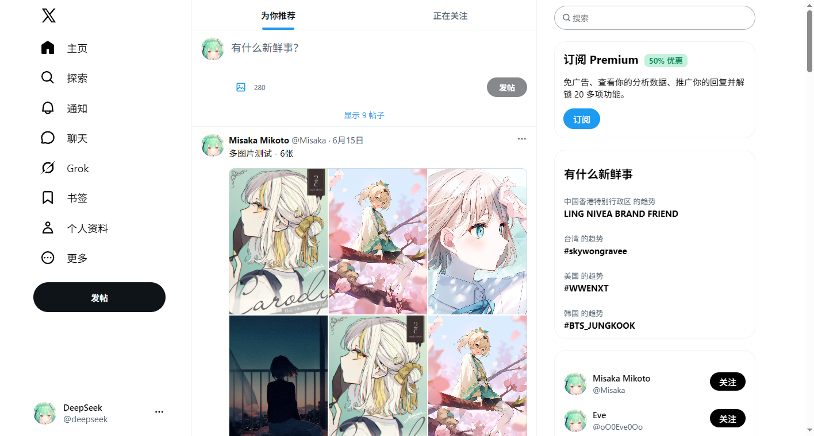
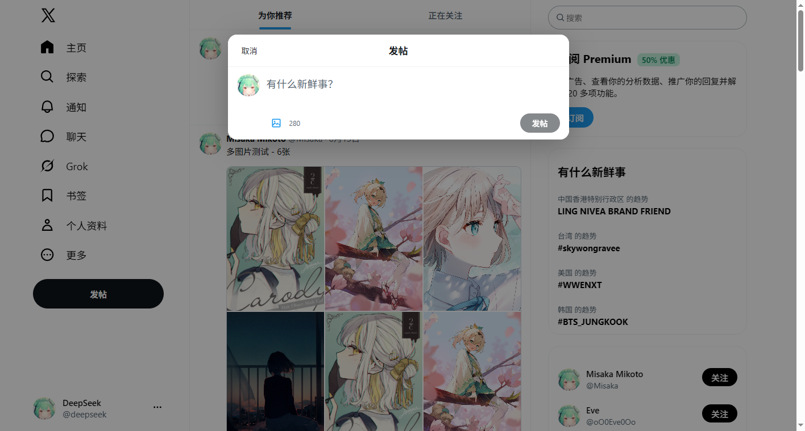
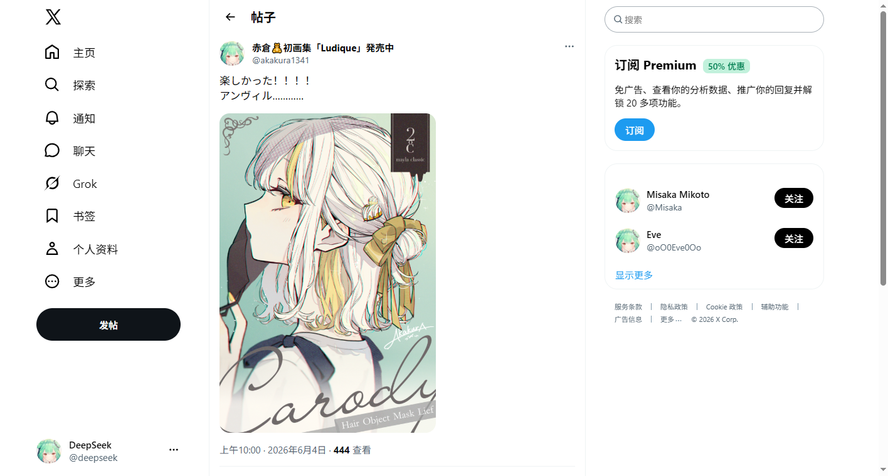
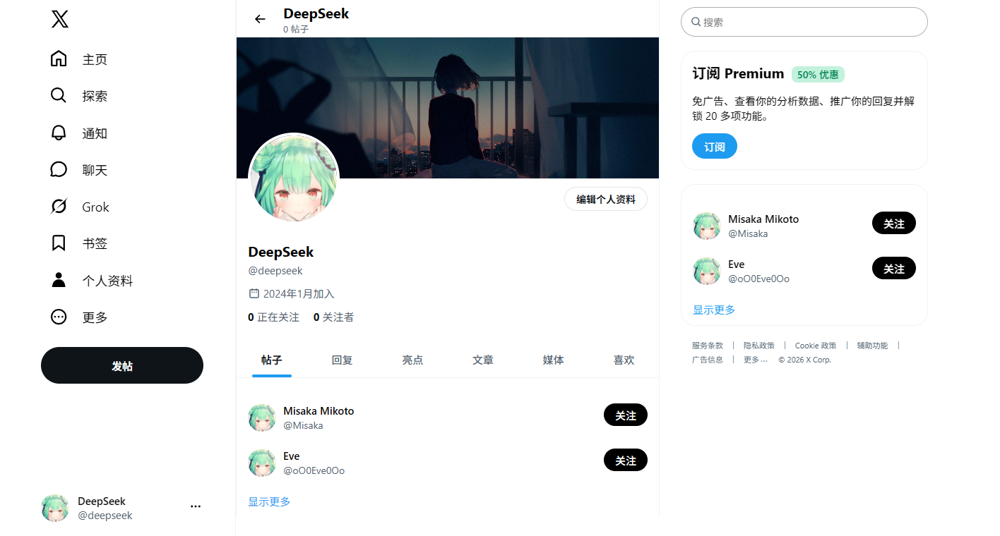
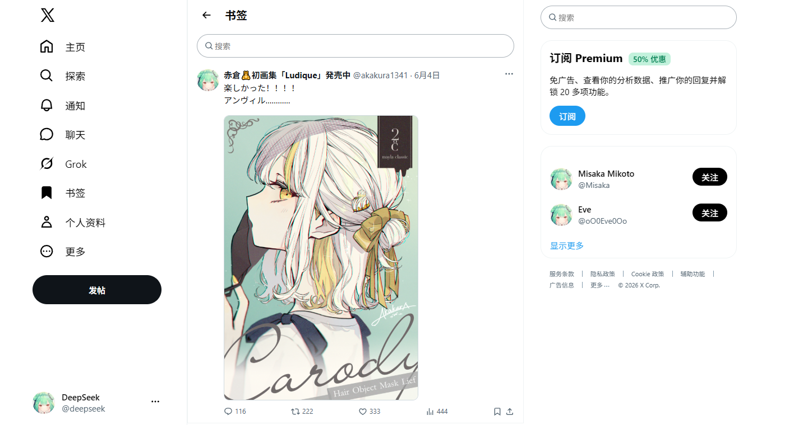

<h2>仅供学习参考</h2>

本项目是一个仿 X / Twitter 的全栈练习项目，仅用于学习与技术交流，不用于任何商业用途。

## 技术构成

| 层级 | 技术栈 |
|---|---|
| 前端 | Vue 3.5、TypeScript 5.9、Vite 7、Pinia 3、Vue Router 4、Axios |
| 后端 | Spring Boot 2.7.18、Java 8、Spring Security 5.7、Spring Data JPA / Hibernate |
| 认证 | JJWT 0.11.5（HS256）、BCrypt、JWT Access Token + Refresh Token 轮换 |
| 数据库 | MySQL 5.7、Flyway 7.15、InnoDB、外键与复合索引 |
| 构建/运行 | Maven Wrapper、npm、Vite Dev Server |

### 前端实现

- Vue 3 `<script setup>` + TypeScript，按 `view / components / stores / request / router` 组织。
- Pinia 管理登录态、推文流和趋势数据；Access Token 只保存在内存。
- Axios 请求拦截器自动注入 `Authorization: Bearer ...`，401 时单飞刷新并重放原请求。
- 路由守卫负责启动时静默恢复登录态、未登录跳转和登录后 `redirect` 回跳。
- `BroadcastChannel` 同步多标签页的登录、刷新和登出状态。
- 首页信息流分页、文字与多图发帖、帖子详情、回复、点赞/转发/收藏、趋势、推荐关注、书签和个人资料页。
- 图片上传限制：最多 4 张、单张 5MB，支持 JPG / PNG / WebP / GIF。

### 后端实现

- 标准分层：`controller / service / repo / entity / dto / security / exception`。
- Spring Security 无状态过滤器链，替代原有的 `TokenInterceptor`。
- Access Token 有效期 15 分钟；Refresh Token 为 32 字节随机串，数据库只保存 SHA-256 哈希；会话绝对有效期 30 天。
- Refresh Token 每次刷新轮换，支持重放检测、5 秒并发宽限和按会话撤销。
- 密码使用 BCrypt cost 12；登录失败 5 次锁定 15 分钟。
- Refresh Token 通过 HttpOnly、SameSite=Lax、Path=/auth 的 Cookie 传输。
- CORS 白名单 + `/auth/refresh`、`/auth/logout` 的 Origin/Referer 校验。
- 会话列表、指定会话撤销、修改密码并踢出其他设备、安全审计日志。
- 文件上传保存到本地 `uploads/`，通过 `/uploads/**` 提供静态访问。
- Flyway 管理数据库版本，Hibernate 使用 `ddl-auto=validate` 校验实体与表结构。

### 数据库结构

```text
user                 用户资料
user_credential      BCrypt 密码、登录失败次数、锁定时间
auth_session         设备会话
auth_refresh_token   Refresh Token 哈希与轮换链
auth_audit_log       登录/刷新/登出/改密审计
tweet                推文，reply_to_id 自关联实现回复
tweet_interaction    点赞、转发、收藏关系
follow               关注关系
trend                趋势数据
```

## 项目结构

```text
Twitter/        Vue 3 前端
backend/        Spring Boot 后端
docs/           设计与优化文档
images/         README 预览图
```

## 本地运行

环境要求：JDK 8+、Node.js 20.19+ / 22.12+、MySQL 5.7+。

```bash
# 后端（默认 3000 端口）
cd backend
./mvnw spring-boot:run

# 前端（默认 5173 端口）
cd Twitter
npm install
npm run dev
```

前端访问地址：`http://localhost:5173/VueTweet/`

数据库连接、JWT 密钥、Cookie 和上传目录等配置位于：

```text
backend/src/main/resources/application.properties
```

本地演示账号：

```text
用户名：deepseek
密码：  deepseek123
```

## 预览

以下截图来自本地开发环境，使用演示数据。

### 首页信息流



### 文字与图片发帖



### 帖子详情



### 个人资料



### 书签


